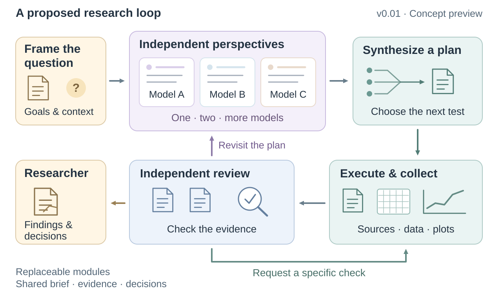
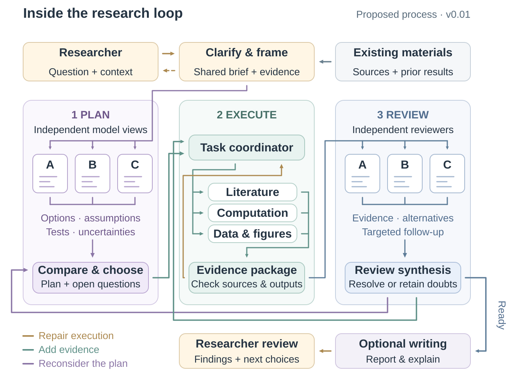
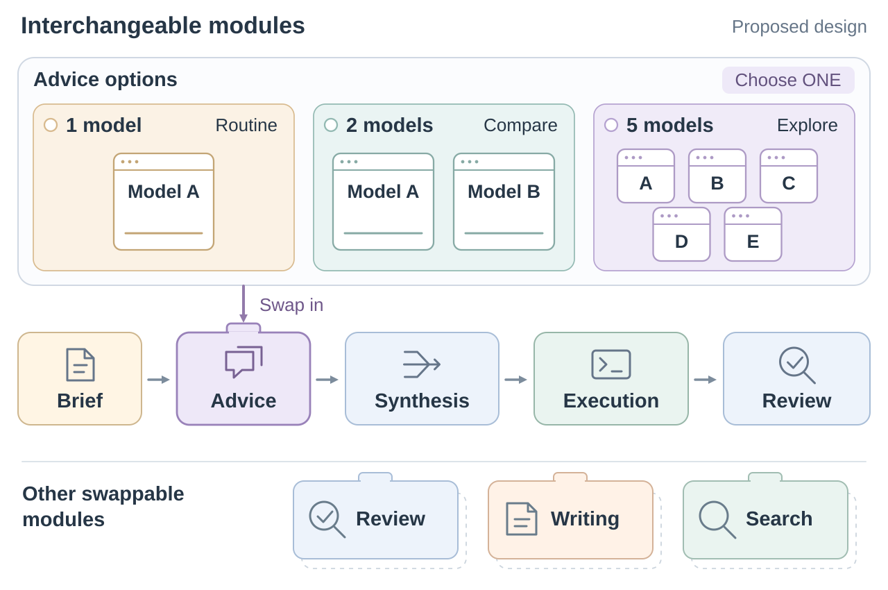

# Loop for Scientific Research

[English](README.md) | **简体中文**

> **v0.01 · 概念预览。** 这是一个正在逐步完善的项目规划与架构提案，可执行集成尚待建设。

**将不同 AI 的独立观点，接入由证据推动的科研循环。**

一个正在规划中的科研 Agent 工作流：理解问题、比较方案、执行任务、审视证据，再决定下一步。研究者确定方向，并作出科学判断。

> [!IMPORTANT]
> **Human-in-the-Loop.** Agent 可能产生幻觉、偏离目标，或追逐无关的数字。把每份报告当作草稿：核对细节和背后的计算，留意 Agent 的工作过程，由研究者纠正并决定下一步。

本版包含简短设计说明、三张附带可编辑源代码的插图，以及三份手工交接模板。

## 从研究问题到下一次验证

顾问模型先围绕同一个问题独立分析，再由综合者比较意见、形成方案。执行团队取得文献与计算结果，审核者检查证据，决定下一步需要处理什么。

执行问题返回局部修复；证据不足时补查或设计新的对照；更深层的疑问则返回方案研判。研究者收到结果、尚存的分歧，以及下一轮可选择的方向。

## 替换一个部件，保留其余流程

针对当前问题，选择一种研判组件：单模型、两个独立模型，或者更广泛的探索小组。它们占据流程中的同一个位置，都向综合环节提交研判意见。

审核、写作和搜索同样可以分别替换。研究者可以直接指定，也可以让获授权的协调者按任务选择；更多模型是一种选项，并不代表结果一定更好。

## 从交接开始

三个模板可用于手工试跑：填写[研究任务简报](templates/research-brief.md)，收集[研判意见](templates/advisor-memo.md)，记录[审核与下一步](templates/review-and-next-step.md)。

拟从 Codex 与 Subagent Manager 起步，通过少量官方 CLI 连接外部顾问。这条连接路径尚未在本项目实现和测试，详见[设计说明](docs/design.md)。

**下一步：** 通过一个可续派的 Codex 子任务连接外部顾问，保留请求、回复与后续追问，再扩展为小型执行与审核循环。

相关独立项目：[Subagent Manager](https://github.com/LiX-Works/subagent-manager)、[COMSOL 工作流](https://github.com/LiX-Works/COMSOL-Agent-Research-Workflow)、[ScholarFetch](https://github.com/LiX-Works/ScholarFetch)、[Origin 绘图](https://github.com/LiX-Works/Origin_MCP-Skill_for_Scientific-Plots)。它们在本项目中的集成仍属规划。

[English](README.md) · [MIT 许可证](LICENSE)
